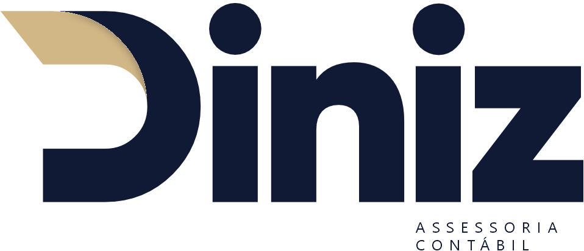
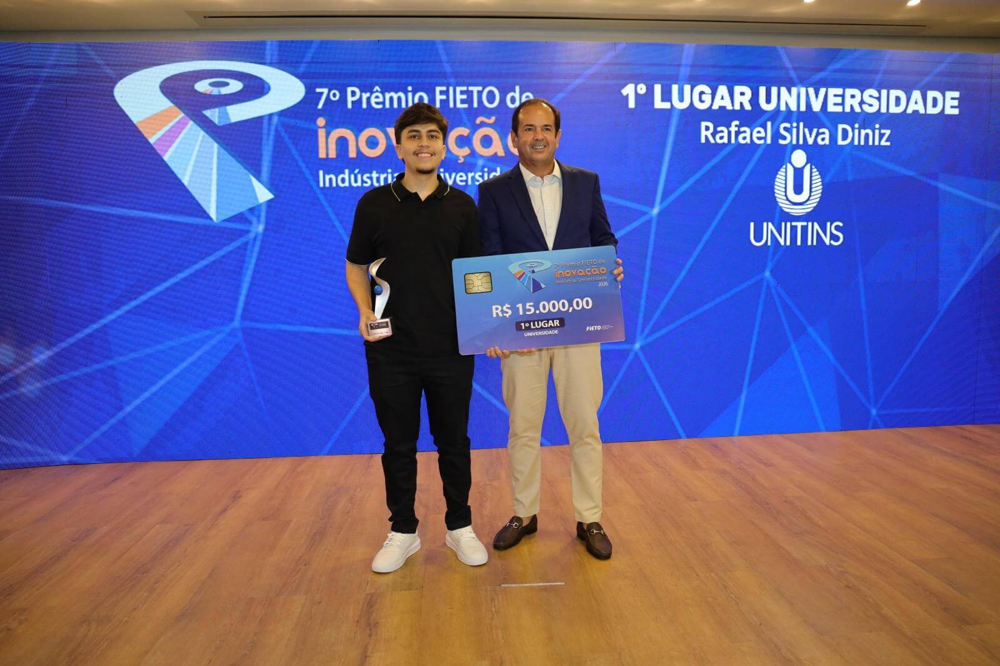
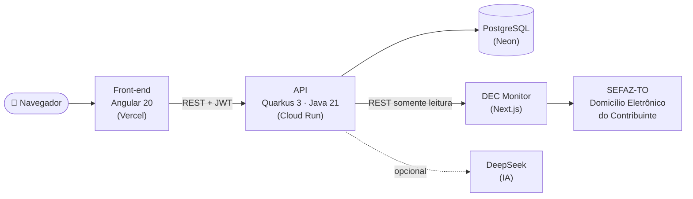

<div align="center">

<picture>
  <source media="(prefers-color-scheme: dark)" srcset="docs/img/diniz-logo-branca.png">
  
</picture>
&nbsp;&nbsp;&nbsp;&nbsp;&nbsp;&nbsp;
<picture>
  <source media="(prefers-color-scheme: dark)" srcset="docs/img/unitins-logo-branca.png">
  
</picture>

# 📅 Prazo Certo — API

### Conformidade fiscal inteligente para empresas do Tocantins

**🏆 1º lugar no 7º Prêmio FIETO de Inovação, na categoria Universidade**

[](https://openjdk.org/projects/jdk/21/)
[](https://quarkus.io)
[](https://neon.tech)
[](Dockerfile)
[](https://gerenciador-diniz-api-408278380894.southamerica-east1.run.app/q/swagger-ui)

[**🌐 Demonstração**](https://prazo-certo-to.vercel.app) ·
[**📖 Swagger**](https://gerenciador-diniz-api-408278380894.southamerica-east1.run.app/q/swagger-ui) ·
[**🎨 Front-end (Angular)**](https://github.com/rafaelsdiniz/PrazoCerto-Angular) ·
[**📰 Notícia do prêmio**](https://www.unitins.br/nPortal/portal/noticias/detalhes/8509-2026-11-19-academico-da-unitins-conquista-1-lugar-na-categoria-universidade-do-7-premio-fieto-de-inovacao)

</div>

---

## 🏆 Prêmio FIETO de Inovação

<div align="center">
  
  <br>
  <sub>Rafael Silva Diniz recebe o troféu de 1º lugar. Foto: Adilvan Nogueira</sub>
</div>

<br>

O **Prazo Certo** ficou em **1º lugar na categoria Universidade do 7º Prêmio FIETO de Inovação**, promovido pela
Federação das Indústrias do Estado do Tocantins. O resultado saiu em 18 de novembro de 2026, numa cerimônia na Escola
Sesi de Referência José Wilson Siqueira Campos, em Palmas-TO. Concorreram 86 projetos, 47 deles na categoria Universidade.

O projeto foi desenvolvido na disciplina **Projeto Integrador II** do curso de **Sistemas de Informação da Unitins**
(Câmpus Palmas), com orientação da **Profª Stephanny Moraes**.

> *"O Prazo Certo foi desenvolvido com o propósito de contribuir para a conformidade fiscal das empresas tocantinenses."*
> — Rafael Silva Diniz

📰 [Matéria completa no portal da Unitins](https://www.unitins.br/nPortal/portal/noticias/detalhes/8509-2026-11-19-academico-da-unitins-conquista-1-lugar-na-categoria-universidade-do-7-premio-fieto-de-inovacao) ·
📸 [Post no Instagram](https://www.instagram.com/p/Df7NrjSh-Lo/)

---

## 📌 Sumário

- [O problema](#-o-problema)
- [A solução](#-a-solução)
- [Demonstração](#-demonstração)
- [Arquitetura](#️-arquitetura)
- [Tecnologias](#-tecnologias)
- [Rodando localmente](#-rodando-localmente)
- [Variáveis de ambiente](#️-variáveis-de-ambiente)
- [Publicação](#-publicação)
- [Estrutura do projeto](#-estrutura-do-projeto)
- [Autor](#-autor)

---

## 🎯 O problema

Um escritório de contabilidade acompanha dezenas de empresas. Cada uma tem obrigações mensais (DAS, FGTS, INSS, ICMS,
DCTFWeb…), documentos que o cliente precisa enviar (extratos, notas de entrada, folha de ponto) e comunicações da
SEFAZ com prazo legal.

Hoje tudo isso circula por **WhatsApp, e-mail e planilhas**. O resultado:

- ⏰ prazos se perdem;
- 💸 guias são pagas com atraso, gerando multa e juros;
- 📬 comunicações da SEFAZ viram **ciência tácita** sem que ninguém tenha lido.

## 💡 A solução

O Prazo Certo reúne num só portal os **documentos, prazos e obrigações fiscais** do escritório (piloto: Diniz
Assessoria Contábil, Palmas-TO) e das empresas clientes. Também traz automaticamente as **comunicações da SEFAZ-TO**
recebidas no Domicílio Eletrônico do Contribuinte (DEC), com a contagem da ciência tácita.

| Funcionalidade | Para quem | O que resolve |
|---|:---:|---|
| 📊 **Painel** | Ambos | Mostra primeiro o que exige ação hoje: vencidos, prazos próximos, documentos a enviar |
| ✅ **Pendências e competência** | Ambos | Cada obrigação do mês com vencimento, competência, status e anexos |
| 🔁 **Obrigações recorrentes** | Escritório | Modelos (DAS dia 20, FGTS dia 7…) que geram as pendências sozinhos |
| 👥 **Responsável pela obrigação** | Ambos | Separa o que o escritório entrega (guias) do que o cliente envia (documentos) |
| 📎 **Anexar guia / enviar documento** | Ambos | O arquivo fica ligado à obrigação, que passa a “entregue” |
| 💳 **Confirmação de pagamento** | Ambos | O cliente confirma o pagamento com comprovante; o escritório vê quem ainda não pagou |
| 📅 **Calendário** | Ambos | Todos os vencimentos do mês |
| 🗂️ **Arquivos (estilo Drive)** | Ambos | Pastas por empresa, arrastar e soltar, visualização, mover e lixeira |
| 📬 **Comunicações DEC** | Ambos | Mensagens da SEFAZ-TO chegam sozinhas, com urgência e contagem da ciência tácita |
| 🔔 **Notificações** | Ambos | O que vence em 7 dias e o que está atrasado |
| 🤖 **Leitura de guias por IA** | Ambos | Lê o PDF e extrai valor, vencimento, CNPJ, competência e linha digitável; sugere a obrigação certa |
| 💬 **Assistente virtual** | Ambos | Responde sobre prazos, guias, certidões e DEC, só com os dados que o usuário pode ver |
| 📜 **Certidões negativas** | Ambos | Validade das CNDs (Federal, Estadual, Municipal, FGTS, Trabalhista, Falência), com aviso 15 dias antes |
| 🧾 **Fechamento mensal** | Escritório | Quadro por competência: aguardando documentos → apuração → guias → concluído |
| ✉️ **Mensagens na obrigação** | Ambos | Conversa entre escritório e cliente dentro de cada obrigação |
| 📈 **Relatórios** | Ambos | Relatório da empresa, da carteira e de pendências, em PDF e CSV |
| 🏢 **Empresas, sócios e usuários** | Escritório | Cadastro da carteira, quadro societário e acessos |
| 🕵️ **Auditoria** | Escritório | Quem fez o quê e quando, com exportação CSV |

## 🚀 Demonstração

| | |
|---|---|
| **Sistema** | https://prazo-certo-to.vercel.app |
| **API (Swagger)** | https://gerenciador-diniz-api-408278380894.southamerica-east1.run.app/q/swagger-ui |

> [!NOTE]
> A API roda no Google Cloud Run, que desliga quando ninguém usa. **O primeiro acesso pode levar alguns segundos.**

**Logins de demonstração** (senha `123456` para todos):

| Perfil | E-mail | O que vê |
|---|---|---|
| Escritório (administrador) | `rafael@diniz.com.br` | Toda a carteira de empresas |
| Cliente | `maria@paoquente.com.br` | Só a Padaria Pão Quente |
| Cliente | `carlos@topecas.com.br` | Só a Auto Peças Tocantins |

Dentro do sistema, a página **Como usar** (menu lateral) traz um roteiro de teste de 5 minutos para cada perfil.
Todos os dados são fictícios, inclusive as comunicações do DEC (LGPD).

## 🏗️ Arquitetura



- **🔐 Autenticação:** JWT com os perfis `ADMIN` (escritório) e `FUNCIONARIO` (cliente); senhas com BCrypt.
- **🛡️ Isolamento por empresa (LGPD):** toda rota confere, pelo token, se o usuário pode ver a empresa
  (`security/UsuarioLogado`). Registros de outra empresa respondem 404, sem revelar que existem.
- **⏱️ Tarefas agendadas** (`SchedulerService`, `DecIntegracaoService`): marcação diária de vencidos, geração mensal
  de pendências e sincronização com o DEC a cada 10 minutos.
- **📬 Integração DEC:** a API lê `GET /api/integracao/comunicacoes` do DEC Monitor e grava por *upsert*, ligando cada
  comunicação à empresa pelo CNPJ. Nada é alterado no DEC.
- **🤖 Inteligência artificial** (`service/ia`, `assistente`): o texto do PDF é extraído com PDFBox e lido por padrões
  (valor, datas, CNPJ, código de barras com validação dos dígitos). Com `DEEPSEEK_API_KEY` configurada, a leitura e o
  assistente usam o modelo DeepSeek; sem a chave, tudo continua funcionando no modo local. O assistente só recebe o
  contexto da empresa do usuário e tem limite de uso.

## 🧰 Tecnologias

| Camada | Tecnologias |
|---|---|
| **Linguagem e framework** | Java 21, Quarkus 3.32, Quarkus REST + Jackson |
| **Persistência** | Hibernate ORM com Panache, PostgreSQL (Neon) |
| **Segurança** | SmallRye JWT, BCrypt, isolamento por empresa |
| **Agendamento** | Quarkus Scheduler |
| **Documentos e IA** | Apache PDFBox, DeepSeek (opcional) |
| **Documentação** | SmallRye OpenAPI + Swagger UI |
| **Infraestrutura** | Docker, Google Cloud Run (`southamerica-east1`) |

## 💻 Rodando localmente

**Pré-requisitos:** Java 21 (o Maven vem pelo `./mvnw`) e um PostgreSQL (local ou Neon gratuito).

**1. Clone o repositório**

```bash
git clone https://github.com/rafaelsdiniz/PrazoCerto-Quarkus.git
cd PrazoCerto-Quarkus
```

**2. Crie um arquivo `.env` na raiz** (ele não vai para o git)

```env
DB_URL=jdbc:postgresql://localhost:5432/diniz?sslmode=disable
DB_USER=postgres
DB_PASSWORD=sua-senha

# opcional: integração com o DEC Monitor
# DEC_URL=https://...vercel.app
# DEC_TOKEN=...
# ou, sem DEC real, comunicações fictícias:
# DEC_DEMO=true
```

**3. Suba a API em modo de desenvolvimento**

```bash
./mvnw quarkus:dev
```

A API sobe em http://localhost:8080, com o Swagger em http://localhost:8080/q/swagger-ui. Em desenvolvimento, o banco é
**recriado a cada início** com os dados de demonstração (`import.sql`), com datas relativas ao mês atual.

**4. Suba o front-end** seguindo o README do [PrazoCerto-Angular](https://github.com/rafaelsdiniz/PrazoCerto-Angular)
e acesse http://localhost:4200.

**Testes automatizados:**

```bash
./mvnw test
```

## ⚙️ Variáveis de ambiente

| Variável | Uso | Padrão |
|---|---|---|
| `DB_URL`, `DB_USER`, `DB_PASSWORD` | Conexão com o PostgreSQL | obrigatórias |
| `PORT` | Porta HTTP | `8080` |
| `CORS_ORIGINS` | Endereço do front-end | `http://localhost:4200` |
| `DB_GENERATION` | Em produção: `update` preserva os dados; `drop-and-create` recria e carrega a demonstração | `update` |
| `JWT_PRIVATE_KEY_LOCATION`, `JWT_PUBLIC_KEY_LOCATION` | Chaves do JWT | chaves de desenvolvimento |
| `DEC_URL`, `DEC_TOKEN` | Integração com o DEC Monitor | desligada |
| `DEC_DEMO` | Comunicações fictícias (demonstração) | `false` |
| `DEEPSEEK_API_KEY` | IA na leitura de guias e no assistente | modo local |

## ☁️ Publicação

Toda a infraestrutura usa planos gratuitos.

- **API:** Google Cloud Run (`southamerica-east1`, mesma região do banco), a partir do [`Dockerfile`](Dockerfile)
  (build Maven + JRE 21):

  ```bash
  gcloud run deploy --source .
  ```

  As chaves do JWT de produção são geradas dentro da imagem e nunca ficam no repositório. Na primeira publicação, use
  `DB_GENERATION=drop-and-create` para criar as tabelas e carregar a demonstração; depois troque para `update`.
  O [`render.yaml`](render.yaml) continua disponível como alternativa.
- **Front-end:** Vercel.
- **Banco:** Neon (PostgreSQL).

## 📁 Estrutura do projeto

```
src/main/java/diniz/contabilidade/arquivos/
├── model/          entidades JPA, enums e value objects (CNPJ, CPF, e-mail, telefone)
├── dto/            contratos da API (request/response)
├── repository/     acesso a dados (Panache)
├── service/        regras de negócio, agendamentos e integração DEC
│   └── ia/         leitura inteligente de documentos (PDFBox + padrões + DeepSeek)
├── assistente/     assistente virtual (chatbot)
├── resource/       endpoints REST
└── security/       usuário logado e isolamento por empresa

src/main/resources/
├── application.properties   configuração (perfis dev, test e prod)
├── import.sql, seed-*.sql   dados de demonstração
└── exemplos/                guias fictícias para testar a leitura por IA
```

## 👨‍💻 Autor

<table>
  <tr>
    <td align="center">
      <a href="https://github.com/rafaelsdiniz">
        <br>
        <b>Rafael Silva Diniz</b>
      </a><br>
      <sub>Sistemas de Informação · Unitins</sub>
    </td>
  </tr>
</table>

**Orientação:** Profª Stephanny Moraes, Universidade Estadual do Tocantins (Unitins), Câmpus Palmas.

### Agradecimentos e referências

- [Quarkus](https://quarkus.io), Hibernate ORM / Panache, SmallRye JWT, Quarkus Scheduler e PostgreSQL.
- Referência de design: [awesome-claude-design](https://github.com/VoltAgent/awesome-claude-design) (MIT), adaptada às
  cores da marca Diniz.
- Integração com o DEC Monitor, sistema próprio do escritório para o Domicílio Eletrônico do Contribuinte (SEFAZ-TO).

---

<div align="center">
  <sub>Feito em Palmas, Tocantins 🌻</sub>
</div>
